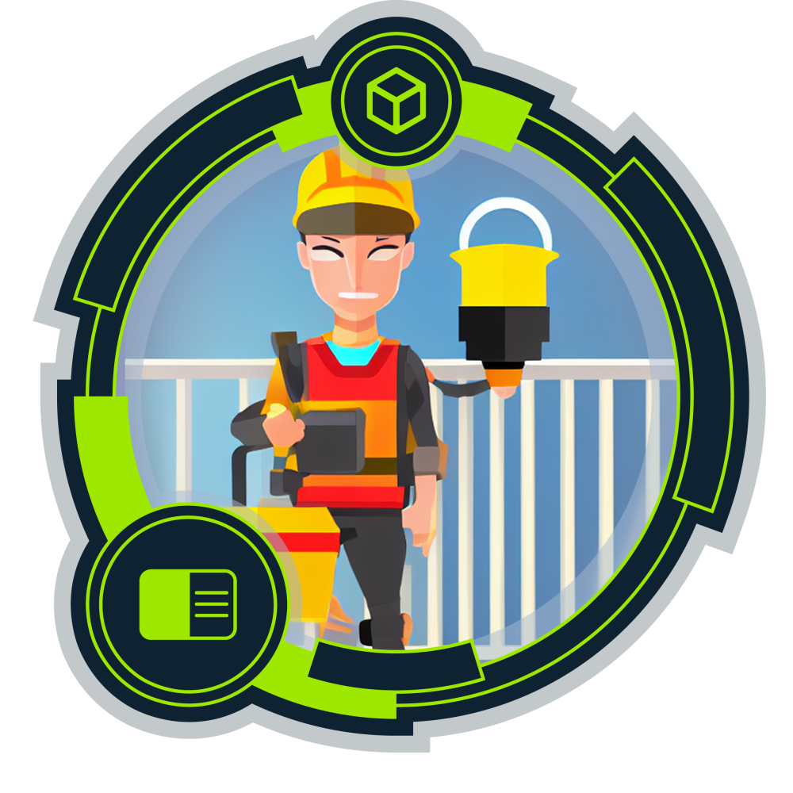
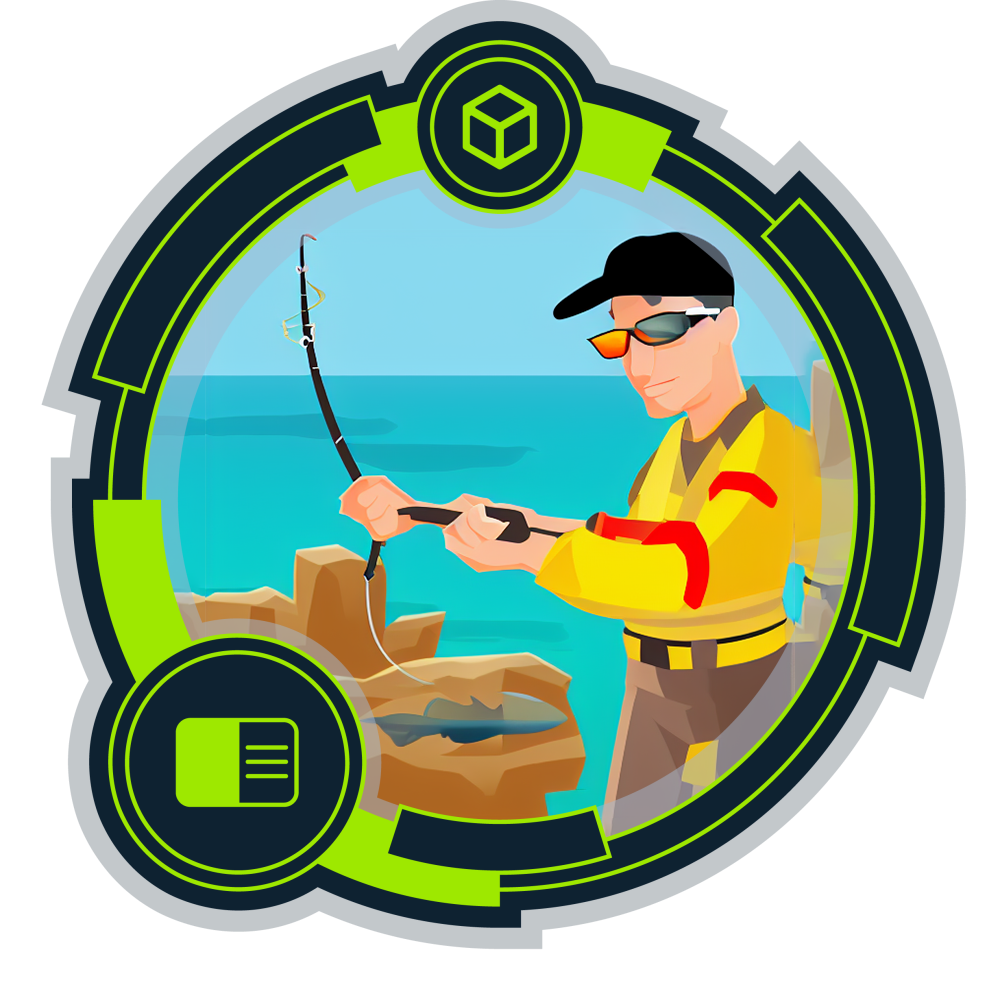
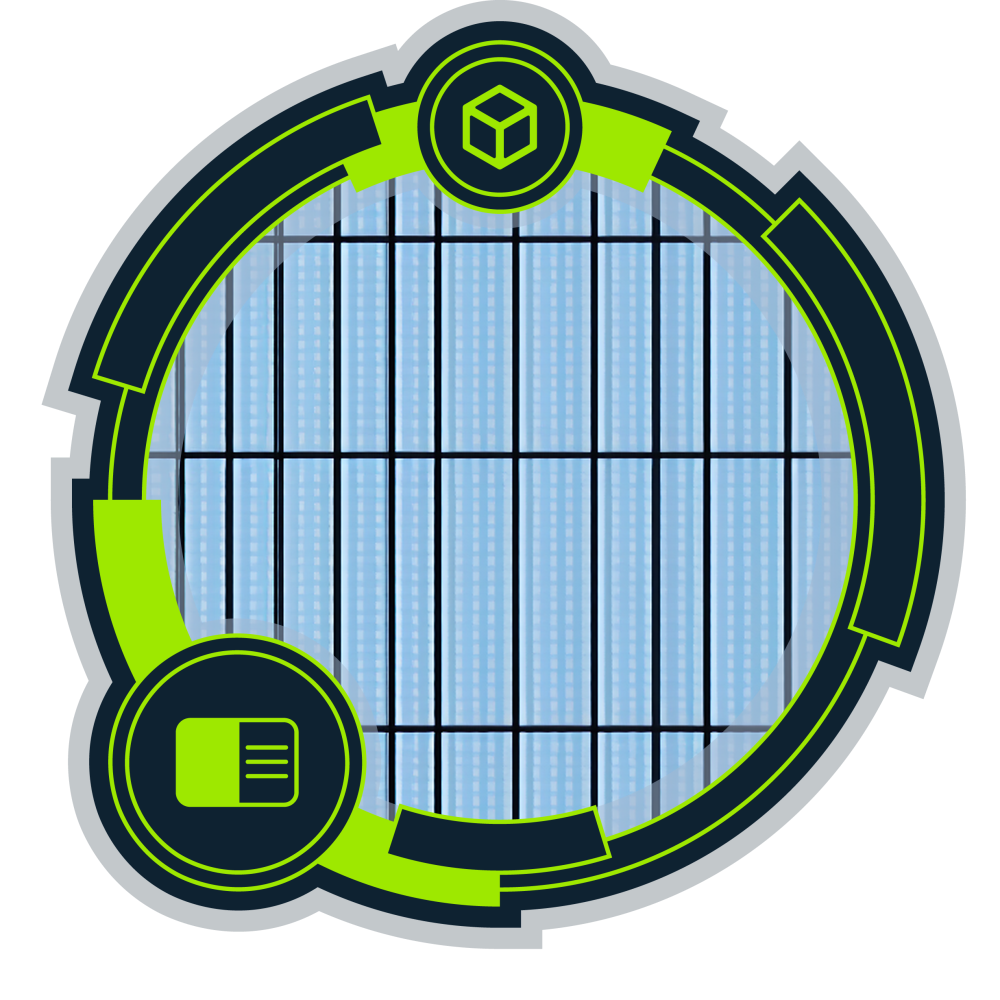

### Mayen Box

Cybersecurity student at HELMo (Liège) · Blue team: SOC, DFIR, threat hunting

I came to IT from physiotherapy. Same reflex, different patient: find what hurts, understand why, and stop it before it spreads. Today that means detection and incident response, from endpoints and networks to the cloud, and to the humans behind the keyboard.

Basically, if it can be hacked, I want to be the one who notices.

<h3 align="center">Hack The Box Academy Badges</h3>

Click a badge to see the official HTB verification

<table align="center">
  <tr>
    <td align="center" width="150">
      <a href="https://academy.hackthebox.com/achievement/badge/598d1f06-e5ef-11f1-8591-0affe7dfeb45" target="_blank">
         
        <b>Alert Striker</b>
      </a> 
      Threat Hunting (IPS/IDS)
    </td>
    <td align="center" width="150">
      <a href="https://academy.hackthebox.com/achievement/badge/0761b31f-da31-11f1-8591-0affe7dfeb45" target="_blank">
         
        <b>SOC Initiate</b>
      </a> 
      SOC Fundamentals
    </td>
    <td align="center" width="150">
      <a href="https://academy.hackthebox.com/achievement/badge/eb78a118-d89d-11f1-8591-0affe7dfeb45" target="_blank">
         
        <b>Hook Breaker</b>
      </a> 
      Phishing Analysis
    </td>
    <td align="center" width="150">
      <a href="https://academy.hackthebox.com/achievement/badge/bfe2f956-d715-11f1-9524-0affe7dfeb45" target="_blank">
         
        <b>Matrix Operative</b>
      </a> 
      MITRE ATT&amp;CK
    </td>
    <td align="center" width="150">
      <a href="https://academy.hackthebox.com/achievement/badge/35d21436-d625-11f1-9524-0affe7dfeb45" target="_blank">
         
        <b>Chainbreaker</b>
      </a> 
      Cyber Kill Chain
    </td>
  </tr>
</table>
