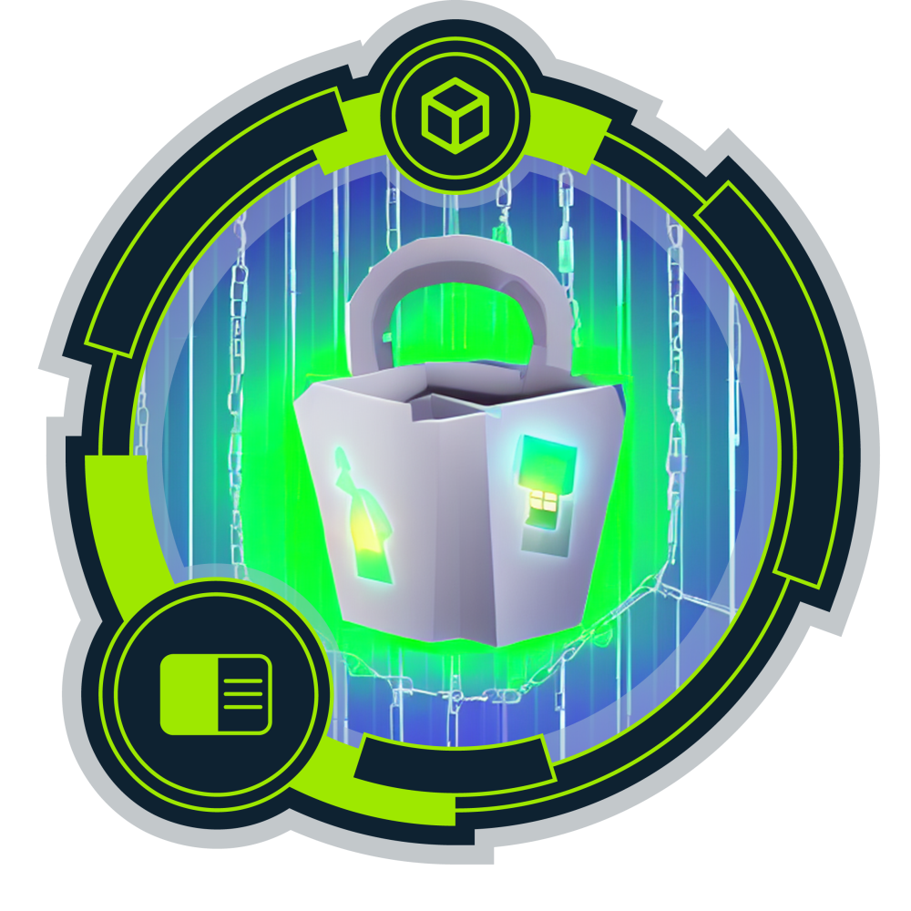

<h3 align="center">Hack The Box Academy Badges</h3>

<table align="center">
  <tr>
    <td align="center" width="150">
      <a href="https://academy.hackthebox.com/achievement/badge/598d1f06-e5ef-11f1-8591-0affe7dfeb45" target="_blank">
         
        <b>Alert Striker</b>
      </a> 
      Threat Hunting (IPS/IDS)
    </td>
    <td align="center" width="150">
       
      <b>SOC Initiate</b> 
      SOC Fundamentals
    </td>
    <td align="center" width="150">
       
      <b>Hook Breaker</b> 
      Phishing Analysis
    </td>
    <td align="center" width="150">
       
      <b>Matrix Operative</b> 
      MITRE ATT&CK
    </td>
    <td align="center" width="150">
       
      <b>Chainbreaker</b> 
      Cyber Kill Chain
    </td>
  </tr>
</table>
